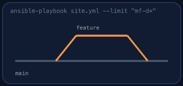
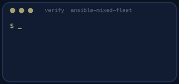

<p align="center"></p>

| | |
|-|-|
| **Time** | 90-105 min |
| **Cost** | free on your own machine |
| **You need** | Ansible (ansible-core 2.15 or newer), Docker, git, an SSH client and a terminal (Linux, macOS, or Windows with WSL) |

## How this lab works

1. **Fork** this repository to your own GitHub account (button at the top right).
2. Clone **your fork** in your Ubuntu environment (WSL on Windows, your OrbStack machine on Mac).
3. Read the lab below (the same text is in [`LAB.md`](LAB.md)) and follow the mission.
4. Answer the questions in [`SUBMISSION.md`](SUBMISSION.md). Where a question asks for output, paste it in a code block. No screenshots needed.
5. Commit and push. Open the **Actions** tab of your fork (click *I understand my workflows, go ahead and enable them* the first time). The **Lab check** shows what is still missing.
6. When the check is green, **submit the URL of your fork** in the course platform.

> [!NOTE]
> The check only looks at your answers and any files the lab asks you to commit. Your instructor reads your work and may ask you to explain any line.

<p align="center"></p>

## 🎬 The situation

<p align="center"></p>

Pollie's company has just bought a small startup. With the startup came two servers running **Debian 12**, and your own two servers run **Ubuntu 24.04**. Management wants all four to follow the same rules this week: the same tools, the same people with the same rights, a file that says what each server is. And they want it done by a playbook, not by hand, because next month there will be six.

The two operating systems are 95% the same, which is exactly why they are dangerous. A package that exists on one and not on the other, a tool that has a different name, a version string that looks different: each is a place where a playbook written for one OS fails on the other. You will write one playbook that **asks each server what it is** and acts accordingly, that **survives the differences** instead of crashing on them, and that changes nothing when nothing needs to change.

> [!IMPORTANT]
> **Your mission**
> - Start four servers (two Ubuntu, two Debian) and reach them with Ansible
> - Let Ansible discover the operating system and build groups from it while the playbook runs
> - Apply the same rules everywhere with loops and conditions, and the OS-specific ones only where they belong
> - Use a `block` with a `rescue` for something that exists on one OS only
> - Prove the second run changes nothing, then repair a server someone broke
> - Tear down and prove it

**Time:** 90-105 min | **Cost:** free | **You need:** Ansible (`ansible-core` 2.15 or newer), Docker, git, an SSH client and a terminal. On Windows use WSL. The servers are containers that behave like servers (systemd, SSH, `apt`).

<p align="center"></p>

## Part 0 - Four servers

Fork this repository, clone your fork and run:

```bash
./setup.sh
ansible fleet -m ping
```

`inventory.ini` and `ansible.cfg` are provided. The inventory has **one group** with the four hosts and **no mention of their operating system**, on purpose. Look at what Ansible knows about them without being told:

```bash
ansible fleet -m setup -a "filter=ansible_distribution*"
```

> [!NOTE]
> **Think** Those values are **facts**, collected by the `setup` module at the start of every play (`gather_facts`). Where would the same information live if you wrote it in the inventory by hand, and what happens to that information when someone upgrades Debian 12 to 13?

<p align="center"></p>

## Part 1 - Let the fleet sort itself

Read the specification in `site.yml`. The first play uses `group_by` to create groups from a fact:

```yaml
- ansible.builtin.group_by:
    key: "os_{{ ansible_distribution }}"
```

After that task runs, the groups `os_Ubuntu` and `os_Debian` exist **for the rest of the playbook**, and later plays can say `hosts: os_Debian`. They are not in your inventory and they disappear when the playbook ends.

Two traps, which are part of the lesson:

- `group_by` reports **changed** every time (it adds a host to a group in memory). That would break the rule "a second run changes nothing". It did not change any server, so tell Ansible: `changed_when: false`.
- Because the groups only exist while the playbook runs, `--limit os_Debian` cannot work (the limit is applied before any task). Use host patterns that exist in the inventory, such as `--limit 'mf-d*'`.

<p align="center"></p>

## Part 2 - What every server gets

Write play 2. Use the module that fits each job (`apt`, `copy`, `user`), not `command` or `shell`:

- **Packages** `htop`, `jq` and `curl`: one task with a list, with `update_cache` and `cache_valid_time` (a fresh server has an empty package index).
- **`/etc/fleet-release`**: one line built from facts. Run the playbook and look at the line on a Debian server and on an Ubuntu server: the version strings are different in shape. Do not "fix" it by hand; your template already says what it says.
- **Users** from a variable. Create `group_vars/all.yml` with `fleet_users` (see its comments) and loop over the list. Users with `sudo: true` join the `sudo` group; the others must not. Think about what `append: true` does and why a `user` task without it can remove someone from groups.
- **A question that is not a change.** `uptime -p` is a read-only command. Run it with `command`, `register` its output, mark it `changed_when: false` and print it with `debug`. Ansible cannot know that a command only reads, so you must say so, and every `command` without a `changed_when` is a place where your second run lies.

Give each group of tasks the tags `packages`, `identity` and `report`.

```bash
ansible-playbook site.yml
ansible-playbook site.yml
```

The second recap must say `changed=0` for all four servers.

> [!NOTE]
> **Predict** Without `when:` or a group, which servers run play 2: all of them? What would the packages task do on a server that is already correct, and why does it say `ok` and not `changed`?

<p align="center"></p>

## Part 3 - What differs

Plays 3 and 4 run only on one operating system each (`hosts: os_Ubuntu`, `hosts: os_Debian`), tagged `os-specific`:

- Ubuntu's firewall front end is `ufw`; Debian 12's is `nftables`. Install the right one on the right OS. (Surprise to check afterwards: does `nftables` also appear on Ubuntu? Why?)
- `update-notifier-common` is an Ubuntu package. On Ubuntu the install works. On Debian it **fails** with "no package". A play that dies there leaves half your fleet configured. Wrap the install in a `block`, and put the fallback in `rescue`: write the line `update-notifier-common is not available on <host>` to `/var/log/ansible-fallback.log`, with `lineinfile` so that a second run does not add it again. The playbook must finish with `failed=0`; the recap shows `rescued=1` for the Debian hosts.

> [!NOTE]
> **Think** `ignore_errors: true` would also have kept the playbook going. What does it hide that `rescue` does not? What would you see in the recap in each case, and which one tells the next engineer something happened?

<p align="center"></p>

## Part 4 - Check mode, limits and repairs

```bash
ansible-playbook site.yml --check --diff                              # a rehearsal: what WOULD change?
ansible-playbook site.yml --limit 'mf-d*' --tags packages --check --diff
docker exec mf-u1 rm /etc/fleet-release                               # somebody "cleans up"
ansible-playbook site.yml --tags identity                             # only the broken server reports a change
```

> [!NOTE]
> **Think** `--check` made no change, yet it computed what would change. Which modules support check mode and what happens with a `command` task in check mode? When would you run `--check --diff` before a real run in production?

<p align="center"></p>

## Part 5 - Prove it

<p align="center"></p>

```bash
./verify.sh
```

It reads your files, runs the playbook twice, inspects each of the four servers (packages, release file, users and groups, the OS-specific tools, the fallback log), then tries tags, limits and check mode, and breaks a file to see whether your playbook repairs it. Fix what is red and run it again until it ends with **ALL CHECKS PASSED**.

> [!TIP]
> **Stuck?** `Unable to locate package` kills the whole play: the install needs a `block`/`rescue`. The second run says `changed=4`: look for `group_by` without `changed_when: false`, a `command` without one, or a `lineinfile` without a stable line. `ansible_distribution_version` on Debian is not `12`: it is a point release like `12.15`. `The group sudo does not exist` can only happen if the sudo package is missing (it is installed by the image). `Failed to set permissions on the temporary files`: install `acl` on the managed hosts or set `ansible_become_method`; here the user `deploy` has passwordless sudo, so `become: true` is enough.

<p align="center"></p>

## Level up (optional)

- Move the OS-specific package names into `group_vars/os_Debian.yml` and `os_Ubuntu.yml` (loaded automatically for the dynamic groups) so one task can say `name: "{{ firewall_package }}"`. Which approach is easier to read when a third OS arrives?
- Add `serial: 1` to roll through the Debian hosts one at a time and `max_fail_percentage: 0`. When would you want that?
- Use `ansible.builtin.package` (the generic module) instead of `apt`. What do you gain, and what do you lose (the `update_cache` option)?
- Write the same playbook for RHEL (`dnf`) by branching on `ansible_os_family`. Which facts would you use instead of `ansible_distribution`?

<!-- teardown:start (generated by labs.py, do not edit) -->
## Tear down (mandatory)

<p align="center"></p>

Resources left behind cost money, keep doors open and pollute the next lab. Removing what you created is part of the job, so it is part of the submission: **you must prove it is gone**.

Do this **last**, after you have pasted your `verify` output into `SUBMISSION.md` (once you tear down, the lab can no longer be verified).

1. Run `./teardown.sh`. It removes the four servers (labelled `lab=ansible-mixed-fleet`), their network, the SSH keys and the generated files. Your Ansible files and answers stay.

Then run the proof:

```bash
./verify-teardown.sh
```

It prints a list of checks and must end with **TEARDOWN VERIFIED**. If it reports leftovers, remove them and run it again. Paste the full output in your submission.
<!-- teardown:end -->

<!-- submission:start (generated by labs.py, do not edit) -->
## 📬 Submission

Answer the questions in `SUBMISSION.md` in **your fork** (paste output in code blocks where asked), push, then submit the **URL of your fork**.

**Files to commit**

- `site.yml`: the playbook
- `group_vars/`: the per-distribution variables

**Questions to answer**

1. Paste `ansible fleet -m setup -a "filter=ansible_distribution*"`. Which facts did you use to tell the servers apart, and where do facts come from (which module collected them and when)?
2. Show how you grouped hosts by their operating system while the playbook runs (`group_by`). Why is that better than writing the distribution into the inventory by hand? What goes wrong with the hand-written version after an OS upgrade?
3. Paste a task that uses `when:` and one that uses `loop:` with a condition. In one sentence each: when is a `when:` evaluated (before or after the task is templated), and what does `item` hold in a loop?
4. Paste the `block`/`rescue` task and its output on Ubuntu and on Debian. Which one took the rescue path, and why is a `rescue` better than `ignore_errors: true`?
5. Paste the `PLAY RECAP` of the first run and of the second (`changed=0`). Which of your tasks would have broken that, and what do `changed_when: false` and `check_mode` tell Ansible?
6. Run `ansible-playbook site.yml --limit "mf-d*" --tags packages --check --diff`. What did `--limit`, `--tags` and `--check` each do? Why can you not write `--limit os_Debian` (hint: when does that group exist)? When would you rely on this in production?
7. Paste the output of `./verify.sh`. It must end with **ALL CHECKS PASSED**.
8. **Tear down.** Paste the output of `./verify-teardown.sh`. It must end with **TEARDOWN VERIFIED**.
<!-- submission:end -->
